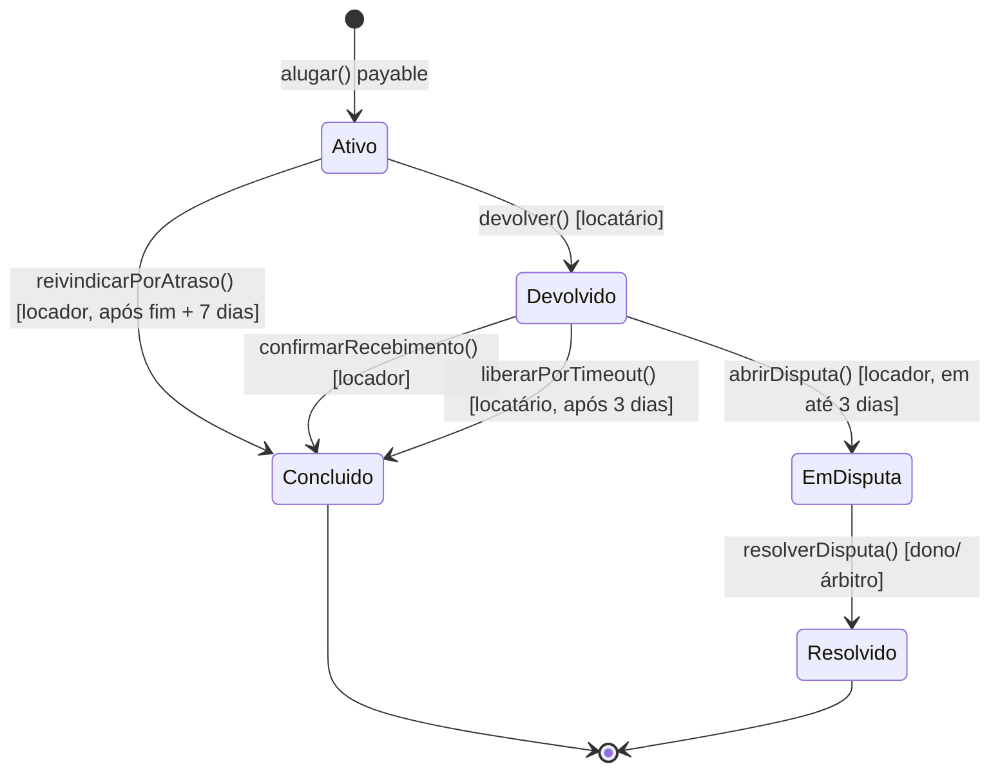

# AluguelEquipamentos: back-end (smart contract)

dApp de aluguel de equipamentos (câmeras, bikes, kits de laboratório) com **caução custodiada pelo contrato**. O contrato é a única fonte de verdade: ele retém o ETH e só o libera conforme o estado do aluguel.

## 1. Por que blockchain aqui?

Hoje o aluguel entre desconhecidos depende de uma plataforma central que segura a caução, decide disputas e pode alterar as regras ou reter o dinheiro. Neste dApp:

- A **caução fica no contrato**, não com uma empresa; as regras de liberação são públicas e imutáveis (código verificado no Etherscan).
- **Ninguém precisa confiar no outro**: se o locatário some, o locador reivindica após prazo fixo; se o locador não responde, o locatário libera sozinho por timeout.
- Todo o histórico (aluguéis, devoluções, disputas) é **auditável** por eventos.

## 2. Diagrama de estados do aluguel



Equipamento: `Disponivel → Alugado → Disponivel` (ou `Inativo` quando o locador desativa ou o item não volta).

## 3. Regras de negócio

- **Valor exato**: `alugar` exige `preço × dias + caução` (nem mais, nem menos).
- **Multa por atraso**: 1 diária por dia (ou fração) de atraso, limitada à caução; descontada da caução e paga ao locador.
- **Taxa da plataforma**: percentual (bps) sobre o valor do aluguel, no máximo 10%. É **congelada no momento da locação** (o dono não pode mudar a taxa de aluguéis em andamento).
- **Liquidação** (`_liquidar`): `locador += (preço − taxa) + parteDaCaução`, `locatário += caução − parteDaCaução`, `dono += taxa`. Invariante testada: saldo do contrato = soma dos saldos sacáveis.
- **Reputação** (`int256`): +1 devolução limpa; −1 atraso ou dano parcial; −2 dano total; −3 abandono; −1 ao locador cuja contestação foi rejeitada.
- **Bloqueio** (mapping aninhado): o locador pode impedir um endereço de alugar um item específico.
- **Árbitro**: o dono decide disputas, mas **não pode arbitrar aluguel em que seja parte**.

## 4. Tabela de recursos × código

Arquivo: `contracts/AluguelEquipamentos.sol` (cada trecho tem o marcador `[Recurso: ...]` no código).

| Grupo | Onde está (linhas) |
|---|---|
| **Tipos de dados** | `constant`: 66–78 · `immutable`: `DONO` 81, `DURACAO_DIA` 83 · `uint256` (preços, prazos) · `int256`: `reputacao` 101 · `bool`: `bloqueados` 103, `_travado` 110 · `address`/`address payable`: structs 35–58 · `string`: `nome`, `NOME` 66 · `bytes32`: `categoria`, `ParametroInvalido` |
| **Funções** | constructor 210 · `external`: `cadastrarEquipamento` 228, `alugar` 284, `devolver` 324, `sacar` 423, etc. · `public`: `calcularMulta` 533, `calcularTaxa` (**pure**) 546 · `internal`: `_finalizarDevolucao` 555, `_liquidar` 573 · `private`: `_corresponde` 583, `_ajustarReputacao` 593 · `view`: 451–533 · **`payable`**: `alugar` 284 |
| **Estruturas de controle** | `if/revert` em `alugar` 288–300 · `if / else if / else` em `resolverDisputa` 390–396 · laço **`for` com limite** (≤ `MAX_POR_PAGINA` = 50) em `listarEquipamentos` 515 e 521 · `require` em 198, 211–212, 236, 384, 435, 441 |
| **Arrays e mappings** | array dinâmico `_equipamentos` 95 · mapping→struct `_alugueis` 97 · simples `saldos` 99, `reputacao` 101 · **aninhado** `bloqueados` 103 (usado em `alugar`) · mapping→array `_alugueisDoLocatario` 105, `_alugueisDoLocador` 107 |
| **Structs e enums** | `StatusEquipamento` 16, `StatusAluguel` 26 · structs `Equipamento` 35 (7 campos), `Aluguel` 46 (12 campos) |
| **Modificadores** | `apenasDono` 168 · `equipamentoExiste(id)` 175 · `aluguelExiste(id)` 182 · **`noEstado(id, estado)` 190 (com parâmetros)** · `semReentrada` 197 |
| **Eventos e erros** | 11 eventos (com `indexed`) 116–144 · 8 erros personalizados com parâmetros 147–161 · `require` com mensagem |

Mais de 6 funções públicas/externas com regra de negócio real: `cadastrarEquipamento`, `alterarDisponibilidade`, `bloquearLocatario`, `alugar`, `devolver`, `confirmarRecebimento`, `liberarPorTimeout`, `abrirDisputa`, `resolverDisputa`, `reivindicarPorAtraso`, `sacar`, `definirTaxa`.

## 5. Segurança (o que decidimos e por quê)

| Risco | Mitigação no código |
|---|---|
| Reentrância no saque | **Checks-Effects-Interactions** em `sacar` (saldo zerado/abatido *antes* do `call`) + modificador `semReentrada` |
| Pagamento direto a terceiros (falha de um destinatário trava o fluxo) | **Pull payment**: as regras só creditam `saldos`; cada um saca o que é seu |
| Uso de `transfer`/`send` (limite de 2300 gás) | `call{value}` com verificação do retorno |
| Acesso indevido | `apenasDono` e checagem de papel (`locador`/`locatário`) em cada função; **nunca** `tx.origin` |
| Valores errados | `alugar` exige valor exato (`ValorIncorreto`); sem `receive`/`fallback` → ETH enviado direto é rejeitado |
| Overflow | Solidity ≥ 0.8 (aritmética verificada) |
| Fundos presos | Timeout do locatário (`liberarPorTimeout`) e abandono (`reivindicarPorAtraso`) |
| Dono mudar regras no meio | Taxa congelada por aluguel; teto de 10%; dono não arbitra caso próprio |
| Laço sem limite (DoS de gás) | Único laço é em `view`, com janela ≤ 50 |

**Limitações assumidas (dizer na arguição):**
1. O árbitro é **centralizado** (o dono). Evolução: múltiplos árbitros ou oráculo/DAO.
2. Se o dono nunca resolver uma disputa, os fundos ficam retidos. Evolução: prazo máximo de arbitragem com divisão padrão.
3. `block.timestamp` pode variar alguns segundos, o que não afeta regras medidas em dias.
4. `alugueisDoLocatario/Locador` retornam o array inteiro (ok para esta escala; em produção, paginar ou usar *indexer*).
5. `DURACAO_DIA` é configurável no deploy para permitir demonstrar atraso/timeout ao vivo. Em produção usa-se `86400`.

## 6. Como testamos

`test/teste-contrato.js` compila o contrato e executa **49 verificações** em blockchain local (ganache) com avanço de tempo: cadastro, valor exato, bloqueio, auto-aluguel, devolução no prazo, multa por atraso, timeout, disputa, abandono, saques, administração e a **invariante de fundos**. Resultado: **49 ok, 0 falhas**.

```bash
npm i solc ganache web3
node test/teste-contrato.js
```

## 7. Deploy na Sepolia pelo Remix

1. Abra https://remix.ethereum.org, crie `AluguelEquipamentos.sol` e cole o código.
2. Aba **Solidity Compiler**: versão `0.8.24` ou superior. Anote versão e se ativou o *optimizer* (precisará disso na verificação).
3. Aba **Deploy & Run**: *Environment* = **Injected Provider – MetaMask**, MetaMask na rede **Sepolia** com ETH de faucet.
4. Argumentos do constructor:
   - `duracaoDia`: `86400` (real) **ou** `120` (demonstração: "1 dia" = 2 minutos, ideal para mostrar multa e timeout no vídeo).
   - `taxaInicialBps`: `200` (2%).
5. Clique em **Deploy** e confirme na MetaMask. Copie o endereço do contrato.
6. **Verifique no Etherscan** (https://sepolia.etherscan.io → *Contract → Verify and Publish*): arquivo único, mesma versão do compilador e mesma configuração de optimizer. Se pedir os argumentos do constructor em ABI-encoded, o Remix os mostra na transação de deploy.
7. Entregue o endereço ao colega do front para colar em `frontend/contrato.js` (`ENDERECO_CONTRATO`).

> Importante: o endereço de deploy só vale para a versão do código que foi implantada. Se alterar o `.sol`, é preciso novo deploy e novo endereço.

## 8. Roteiro de teste manual (Remix ou Sepolia, 3 contas: dono, locador, locatário)

Categoria `CAMERA` em bytes32: `0x43414d4552410000000000000000000000000000000000000000000000000000`

| # | Conta | Ação | Resultado esperado |
|---|---|---|---|
| 1 | locador | `cadastrarEquipamento("Canon R6", <categoria>, 1000000000000000, 5000000000000000)` | evento `EquipamentoCadastrado`; `totalEquipamentos` = 1 |
| 2 | locatário | `custoTotal(0, 2)` | `7000000000000000` (0,007 ETH) |
| 3 | locatário | `alugar(0, 2)` com value `6000000000000000` | **reverte** `ValorIncorreto` |
| 4 | locatário | `alugar(0, 2)` com value `7000000000000000` | ok; item `Alugado`; contrato retém 0,007 ETH |
| 5 | locador | `alugar(0, 1)` | **reverte** (item indisponível / locador) |
| 6 | locatário | `devolver(0)` | aluguel `Devolvido` |
| 7 | locatário | `confirmarRecebimento(0)` | **reverte** `NaoAutorizado` |
| 8 | locador | `confirmarRecebimento(0)` | `Concluido`; `saldos(locador)` = 0,00196 ETH; `saldos(locatário)` = 0,005 ETH; `saldos(dono)` = 0,00004 ETH |
| 9 | locatário | `sacar(5000000000000000)` | recebe a caução; `saldos` zera |
| 10 | locatário | `sacar(1)` | **reverte** `SaldoInsuficiente` |
| 11 | dono | `definirTaxa(300)` | evento `TaxaAlterada` |
| 12 | locatário | `definirTaxa(300)` | **reverte** `NaoAutorizado` |
| 13 | locatário | (deploy com `duracaoDia=120`) `alugar(0,1)`, esperar ~4 min, `devolver` | `calcularMulta` > 0; ao concluir, o locador recebe a multa |
| 14 | locador | `abrirDisputa` após devolução, e dono `resolverDisputa(id, valor)` | `Resolvido`; caução dividida |

## 9. Perguntas prováveis na arguição

- **Por que pull payment?** Evita que o fracasso de um destinatário trave a liquidação e reduz a superfície de reentrância: as regras só mexem em `saldos`.
- **O que é checks-effects-interactions?** Validar, atualizar o estado e só então chamar o endereço externo. Em `sacar`, o saldo é abatido antes do `call`.
- **Por que `immutable` em `DONO` e `DURACAO_DIA`?** São definidos uma vez no constructor, economizam gás (não ocupam slot de storage) e ninguém pode alterá-los depois.
- **Por que erros personalizados em vez de só `require`?** Custam menos gás e carregam parâmetros úteis ao frontend (`ValorIncorreto(enviado, esperado)`).
- **Onde pode haver laço sem limite?** Em nenhum lugar de escrita: o único `for` é uma consulta paginada com teto de 50.
- **E se o locatário nunca devolve? E se o locador nunca confirma?** `reivindicarPorAtraso` e `liberarPorTimeout` resolvem cada caso sem depender do outro lado.
- **Qual a maior fraqueza?** O árbitro centralizado (limitação 1).
